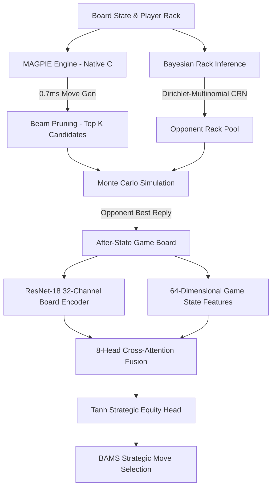

# Alphable V4

Alphable V4 is an open-source, championship-tier Scrabble AI engine. It combines native C move generation ([MAGPIE](https://github.com/jvc56/MAGPIE)), Bayesian opponent rack inference, and a deep value network (ResNet-18 board encoder with 8-head cross-attention over game state features) driven by Belief-Augmented Monte Carlo Search (BAMS).

In a rigorous 3,000-game duplicate tournament (zero tile luck), Alphable V4 achieved a **54.7% match win rate** ($p = 0.00021$) over Base MAGPIE with an average score differential of **+7.1 points per game**.

---

## Quickstart (Under 2 Minutes)

### Prerequisites
- **OS**: Linux (x86_64, aarch64) or macOS (Apple Silicon / Intel)
- **Python**: 3.10, 3.11, or 3.12
- **Build Tools**: GCC or Clang, `make`, `git`

### 1. Automated Installation
Run the installer from inside the `Alphable_V4` directory:

```bash
cd Alphable_V4
./install.sh
```

The script automatically:
1. Creates a Python virtual environment (`venv`).
2. Installs all required packages (`torch`, `scipy`, `pandas`, `pyarrow`, `tqdm`, `pytest`).
3. Compiles the native C MAGPIE shared library (`vendor/magpie/bin/libmagpie.so` or `.dylib`).
4. Verifies the neural value network weights (`models/checkpoints/v4_value_net_best.pt`).
5. Runs an initial smoke test to confirm move generation and neural inference.

### 2. Activate Environment & Run Tests
```bash
source venv/bin/activate
pytest tests/ -v
```
All 59 unit and integration tests should pass in about 20 seconds.

---

## Core CLI Commands

The `cli.py` tool provides everything needed to inspect models, play interactively, analyze moves, and run tournaments.

### 1. Inspect Available Models
```bash
python cli.py models
```
Displays registered model presets, active checkpoint paths, search parameters, and verified tournament win rates.

### 2. Play Against Alphable in the Terminal
```bash
python cli.py play --model latest
```
Starts an interactive terminal Scrabble game with an ASCII board display. Type `hint` on any turn to see BAMS move recommendations, or enter plays in standard Scrabble notation (e.g., `8H CATS` or `-ABC` to exchange).

### 3. Analyze Any Position
```bash
# Analyze opening rack
python cli.py analyze --model latest --rack "AQRTUYZ"

# Analyze rack on a mid-game board with hook word
python cli.py analyze --model latest --rack "TRAINER" --board-word "QUIZ" --board-coord "8D"
```
Compares Base MAGPIE (static equity) against Alphable V4 (neural BAMS valuation) move-by-move.

### 4. Run Tournaments
```bash
# Standard 100-game tournament vs Base MAGPIE
python cli.py tournament --opponent magpie --games 100

# Zero-Luck Duplicate Tournament (paired rack seeds with seat swaps)
python cli.py tournament --opponent magpie --games 50 --duplicate

# Model vs model comparison
python cli.py tournament --model latest --opponent 5-frontiers --games 50
```

### 5. Tournament History & Ledgers
```bash
# View all recorded benchmark runs
python cli.py history

# Inspect a specific run in detail
python cli.py history --show run_20261015_215837

# Compare two runs side-by-side with statistical delta
python cli.py history --compare run_20261013_143000 run_20261015_215837
```

### 6. Neural Network Ablation
```bash
python cli.py ablation --model latest --games 20
```
Tests identical game seeds with neural evaluation toggled ON versus OFF to isolate the exact point contribution of the neural value network.

---

## System Architecture

Alphable V4 uses a multi-stage hybrid pipeline to balance search depth with millisecond latency:



### Key Components

1. **Move Generation (`alphable_v4/engine/`)**
   - Native C MAGPIE engine wrapped via Python `ctypes`.
   - Generates all legal moves for any rack in **0.72 ms** with complete CSW24 and NWL23 lexicon accuracy.

2. **Belief Inference (`alphable_v4/models/belief_net.py`)**
   - Bayesian Dirichlet-multinomial sampling from unseen bag tiles.
   - Common Random Numbers (CRN) across candidates to ensure zero-variance evaluation baselines.

3. **Neural Valuation (`alphable_v4/models/value_net.py`)**
   - 32-channel board tensor encoding letter placement, tile values, blank locations, and board premium squares.
   - 64-dimensional dense state vector encoding score differentials, rack leave metrics, unseen vowel/consonant ratios, and timing indicators.
   - Multi-head cross-attention layer linking board spatial features to game state context, evaluated in **1.96 ms** for batches of 100 candidate after-states on GPU.

4. **BAMS Search (`alphable_v4/search/bams.py`)**
   - Belief-Augmented Monte Carlo Search with defensive vulnerability penalties.
   - Asymmetric volatility scaling: protects score leads while trailing positions hunt high-variance tactical hooks.
   - Deterministic endgame alpha-beta solver when bag tile count drops below 9.

---

## Empirical Benchmarks

| Milestone Benchmark | Games | Win Rate | V4 Mean Score | Opp Mean Score | Net Spread | Statistical Confidence |
| :--- | :---: | :---: | :---: | :---: | :---: | :---: |
| **Duplicate (Zero Tile Luck) vs Base MAGPIE** | **3,000** | **54.7%** | **460.5 pts** | **453.5 pts** | **+7.1 pts** | $p = 0.00021$ ($95\%\text{ CI: } [52.2\%, 57.3\%]$) |
| **Standard 1,000 Games vs Base MAGPIE** | 1,000 | 54.2% | 458.1 pts | 448.3 pts | +9.8 pts | $p < 0.01$ |
| **V4 Scaled Champion vs V4 Baseline (1-Ply)** | 50 | 56.0% | 462.4 pts | 453.1 pts | +9.3 pts | Head-to-head validation |
| **V4 vs Alphable V3 (Macondo ResNet)** | 100 | 65.5% | 457.4 pts | 442.4 pts | +15.0 pts | Full generational leap |
| **V4 vs Score-Greedy Baseline** | 10 | 100.0% | 492.6 pts | 312.4 pts | +180.2 pts | Decisive superiority |

For detailed methodology, sample size formulas, and variance reduction proofs, see the [Statistical Significance Guide](docs/STATISTICAL_SIGNIFICANCE_AND_BENCHMARKING_GUIDE.md).

---

## Python API Usage

You can also use Alphable V4 directly as a Python library:

```python
from alphable_v4.engine.magpie_bindings import MagpieEngine
from alphable_v4.engine.game_state import GameState
from alphable_v4.search.bams import BAMSSearch, BAMSConfig

# Initialize engine and search instance
engine = MagpieEngine(lexicon="CSW24")
bams = BAMSSearch.from_checkpoint(
    engine,
    checkpoint_path="models/checkpoints/v4_value_net_best.pt",
    config=BAMSConfig(num_samples=32, candidate_beam=15)
)

# Set up current board position and player rack
state = GameState(rack=["A", "Q", "R", "T", "U", "Y", "Z"])

# Select best move
best_move, metadata = bams.select_move(state)
print(f"Chosen Play: {best_move} | Word Score: {best_move.score} | BAMS Score: {metadata['best_bams_score']:.2f}")
```

---

## Repository Structure

```
Alphable_V4/
├── install.sh                  # One-click installation and verification script
├── requirements.txt            # Python dependencies (PyTorch, SciPy, etc.)
├── pyproject.toml              # Build config and pytest configuration
├── cli.py                      # Master command-line interface
│
├── alphable_v4/                # Core Python package
│   ├── engine/                 # MAGPIE C engine bindings & game representations
│   │   ├── magpie_bindings.py  # ctypes wrapper for libmagpie
│   │   ├── game_state.py       # 15×15 Scrabble grid, CGP, tensors & vectors
│   │   └── move.py             # Move dataclass, coordinates, and notation
│   ├── models/                 # Neural architectures & weights
│   │   ├── value_net.py        # ResNet-18 + Multi-Head Cross-Attention Value Net
│   │   └── belief_net.py       # Opponent rack Bayesian sampler & tracking
│   ├── search/                 # Strategic search algorithms
│   │   └── bams.py             # Belief-Augmented Monte Carlo Search (BAMS)
│   ├── platform/               # Tournament runner & platform adapters
│   │   ├── eval.py             # Match and tournament simulation loops
│   │   ├── history.py          # JSON ledger of benchmark runs & comparisons
│   │   └── woogles_bot.py      # Woogles.io bot interface
│   └── training/               # Distillation and RL pipelines
│       ├── parse_gcg.py        # High-throughput GCG record parser
│       ├── build_value_dataset.py
│       └── train_rl.py         # Anchored dynamic damping RL fine-tuner
│
├── vendor/
│   └── magpie/                 # Native C MAGPIE engine source & headers
│       └── bin/libmagpie.so    # Compiled shared library
│
├── models/
│   └── checkpoints/
│       └── v4_value_net_best.pt # Value network checkpoint (52.6 MB stripped)
│
├── docs/                       # Complete Diátaxis documentation suite
│   ├── GETTING_STARTED.md      # Detailed installation and first steps tutorial
│   ├── USER_GUIDE.md           # Comprehensive command line reference
│   ├── ARCHITECTURE.md         # Deep technical specification
│   ├── MODELS_AND_RESOURCES.md # Model weights and parameter configurations
│   ├── TOURNAMENT_BENCHMARKS_AND_COMMAND_MANUAL.md # Full benchmark logs
│   ├── STATISTICAL_SIGNIFICANCE_AND_BENCHMARKING_GUIDE.md # Benchmark statistics
│   └── ROADMAP_TO_58_PERCENT.md # Future architectural directions
│
└── tests/                      # Automated test suite (59 passing tests)
    ├── engine/                 # MAGPIE bindings and game state parity tests
    ├── models/                 # Neural tensor shape and latency tests
    ├── search/                 # BAMS move selection & endgame solver tests
    ├── platform/               # CLI and tournament runner tests
    └── training/               # GCG parser and RL fine-tuning tests
```

---

## Documentation Index

Alphable V4 follows the [Diátaxis](https://diataxis.fr/) framework:

| Section | Document | Summary |
|---|---|---|
| **Tutorial** | [GETTING_STARTED.md](docs/GETTING_STARTED.md) | Complete step-by-step setup walkthrough, manual fallback, and first run. |
| **How-To** | [USER_GUIDE.md](docs/USER_GUIDE.md) | How to use every CLI command, customize parameters, and run evaluations. |
| **How-To** | [STATISTICAL_SIGNIFICANCE_AND_BENCHMARKING_GUIDE.md](docs/STATISTICAL_SIGNIFICANCE_AND_BENCHMARKING_GUIDE.md) | How to run zero tile-luck duplicate tournaments, sample sizes, and p-values. |
| **Reference** | [TOURNAMENT_BENCHMARKS_AND_COMMAND_MANUAL.md](docs/TOURNAMENT_BENCHMARKS_AND_COMMAND_MANUAL.md) | Comprehensive record of all historical benchmark runs and command examples. |
| **Reference** | [MODELS_AND_RESOURCES.md](docs/MODELS_AND_RESOURCES.md) | Checkpoint locations, neural shapes, search presets, and file sizes. |
| **Reference** | [ARCHITECTURE.md](docs/ARCHITECTURE.md) | Formal mathematical specifications for BAMS, tensors, and network layers. |
| **Explanation** | [ROADMAP_TO_58_PERCENT.md](docs/ROADMAP_TO_58_PERCENT.md) | Analysis of remaining win-rate headroom and tactical scaling plans. |
| **Explanation** | [PHASE0_RESULTS.md](docs/PHASE0_RESULTS.md) to [PHASE4_RESULTS.md](docs/PHASE4_RESULTS.md) | Phase-by-phase design rationales, ablations, and experimental results. |

---

## License

Alphable V4 is open source under the MIT License. The bundled MAGPIE engine is licensed separately under its respective open-source terms.
