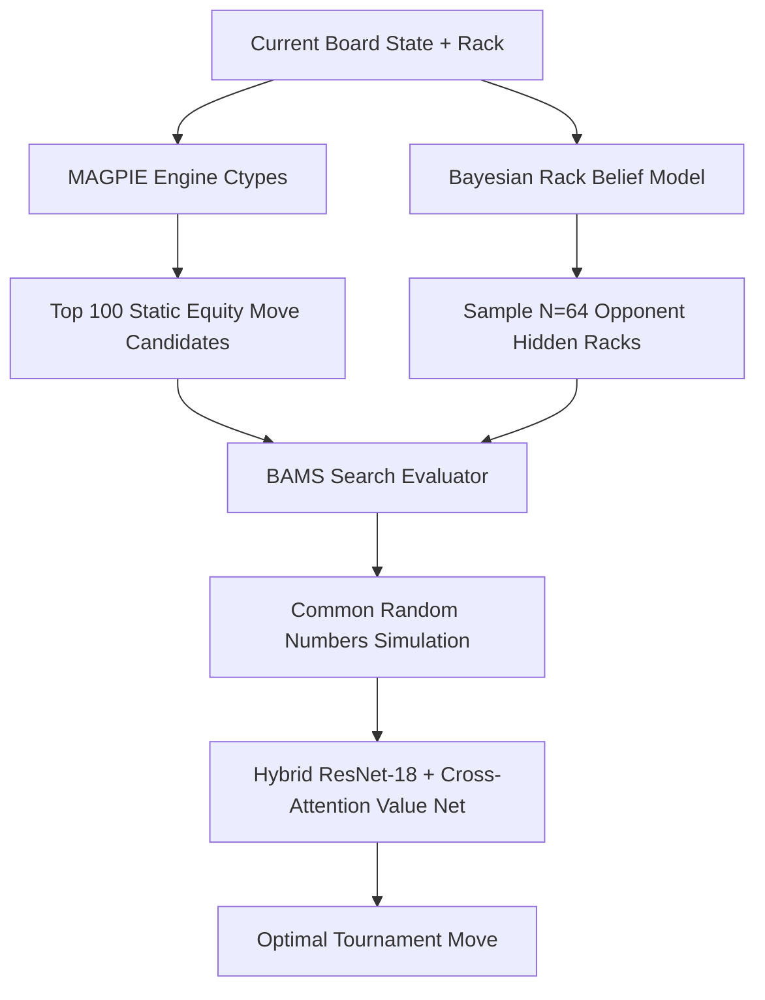

# Alphable V4 — System Architecture

Alphable V4 is a next-generation tournament Scrabble AI combining:
1. **MAGPIE C-Native Engine**: Ultra-fast move generation and KLV leave valuation via `libmagpie.so`.
2. **Belief-Augmented Monte Carlo Search (BAMS)**: Opponent hidden rack inference with Common Random Numbers (CRN) variance reduction.
3. **Hybrid ResNet-18 + Cross-Attention Value Network**: 32-channel spatial board tensor cross-attended over a 64-dimensional dynamic state vector.
4. **Macondo Ground-Truth Equity Distillation**: Continuous deficit labeling anchored against 200,000+ grandmaster-analyzed positions.

---

## 1. System Pipeline



---

## 2. Representation Specifications

### Board Tensor (32 Channels, 15×15 Grid)
- **Channels 0–25:** One-hot indicator planes for English alphabet letters `A` through `Z`.
- **Channel 26:** Designated blank tile indicator plane (identifies blank tiles assigned to letters).
- **Channels 27–30:** Dynamic premium square masks (`DL`, `TL`, `DW`, `TW`) — active (1.0) when square is unoccupied, zeroed (0.0) once covered by a tile.
- **Channel 31:** Current player rack overlap / hook plane (marks board letters matching our rack for rapid bingo anchor detection).

### Game State Vector (64 Dimensions)
- **Dims 0–25:** Tile counts for `A` through `Z` on current player rack.
- **Dim 26:** Blank tile count on current player rack.
- **Dim 27:** Normalized score differential `(our_score - opp_score) / 500.0`.
- **Dim 28:** Normalized remaining bag tile count `bag_count / 100.0`.
- **Dims 29–35:** Strategic leave metrics (leave length / 7.0, vowel ratio, consonant ratio, blank flag, 'S' flag, duplicate penalty, bingo/out flag).
- **Dims 36–61:** Unseen tile ratios for `A` through `Z` relative to English Scrabble pool.
- **Dim 62:** Unseen blank tile ratio `unseen_blanks / 2.0`.
- **Dim 63:** Bayesian rack belief confidence / entropy score.

---

## 3. Directory Layout

```
Alphable_V4/
├── README.md
├── pyproject.toml
├── vendor/
│   └── magpie/             # MAGPIE C engine (compiled to bin/libmagpie.so)
├── engine/
│   ├── magpie_bindings.py  # ctypes wrapper for libmagpie.so
│   ├── game_state.py       # 15x15 board, CGP, 32-ch tensor, 64-dim vector
│   └── move.py             # Move dataclass, coordinate/UCGI parsers
├── models/
│   ├── belief_net.py       # Bayesian & Neural opponent rack inference
│   ├── value_net.py        # Hybrid ResNet-18 + Cross-Attention value network
│   └── checkpoints/        # Model weights
├── search/
│   └── bams.py             # Belief-Augmented Monte Carlo Search
├── training/
│   ├── collect_woogles.py  # Scrape grandmaster matches from Woogles archive
│   ├── parse_gcg.py        # Parse .gcg logs into structured training samples
│   ├── macondo_distill.py  # Scale Macondo equity evaluation pipeline
│   ├── train_value.py      # Value network supervised training
│   └── train_rl.py         # Dynamic damping self-play RL (Phase 4)
├── platform/
│   ├── woogles_bot.py      # WebSocket bot client with multi-lexicon support
│   └── eval.py             # Head-to-head match harness vs HastyBot/BestBot
└── tests/
    ├── engine/             # Parity and latency verification suites
    ├── models/             # Neural network architecture & tensor unit tests
    ├── search/             # BAMS search verification
    └── training/           # Data ingestion & loss calculation tests
```
