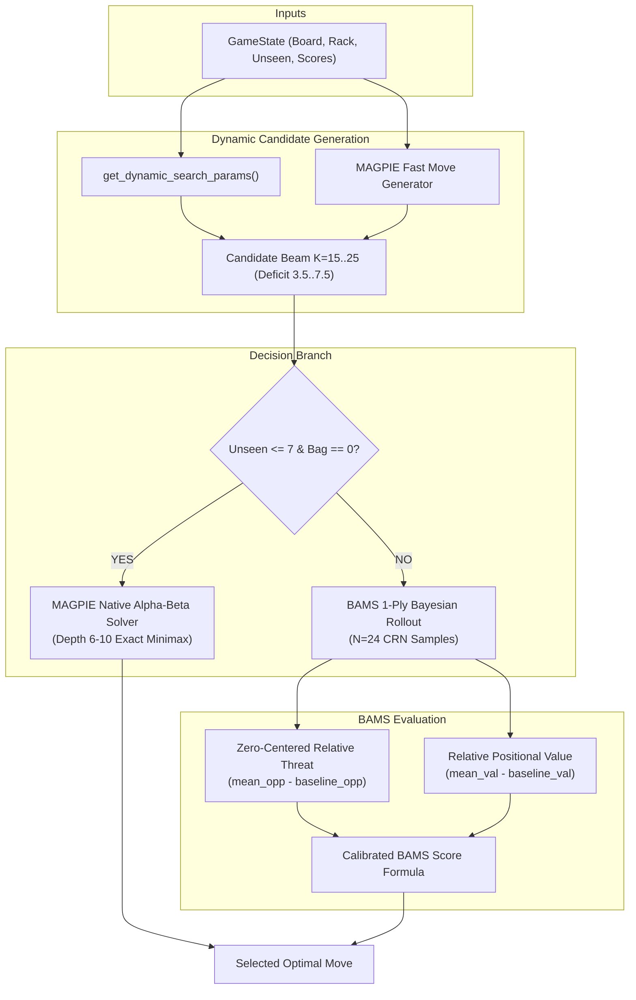

# Alphable V4: Tournament Benchmarks & Master Command Manual

**Location**: `Alphable_V4/docs/TOURNAMENT_BENCHMARKS_AND_COMMAND_MANUAL.md`  
**Last Updated**: 2026-10-13  
**Status**: Verified & Active Reference  

---

## 1. Master Command Catalog

All commands are run using the project virtual environment (`/home/targed/Documents/Git/Alphable/venv/bin/python`) from the `Alphable_V4` directory.

### A. Head-to-Head Tournament Series
Run multi-game tournament series with automatic first-player alternating (`g % 2 == 0`) between BAMS and baselines:

```bash
# 1. Official 1,000-Game Tournament vs Base MAGPIE (KLV Static Equity Top Move)
PYTHONPATH=. /home/targed/Documents/Git/Alphable/venv/bin/python cli.py tournament --opponent magpie --games 1000

# 2. Quick 20-Game Calibration Benchmark vs Base MAGPIE
PYTHONPATH=. /home/targed/Documents/Git/Alphable/venv/bin/python cli.py tournament --opponent magpie --games 20

# 3. Tournament vs Alphable V3 Macondo ResNet Champion
PYTHONPATH=. /home/targed/Documents/Git/Alphable/venv/bin/python cli.py tournament --opponent v3-resnet --games 100

# 4. Tournament vs Alphable V3 SmolLM2-135M Transformer Candidate Ranker
PYTHONPATH=. /home/targed/Documents/Git/Alphable/venv/bin/python cli.py tournament --opponent v3-transformer --games 10

# 5. Tournament vs Score-Greedy Baseline (Validates tactical floor)
PYTHONPATH=. /home/targed/Documents/Git/Alphable/venv/bin/python cli.py tournament --opponent greedy --games 20
```

### B. Specialized Diagnostic & Duplicate Benchmarks
```bash
# Run the Duplicate Pair-Swapped Tournament (Zero Tile Luck Benchmark, 30 games = 15 pairs)
PYTHONPATH=. /home/targed/Documents/Git/Alphable/venv/bin/python scratch/run_enhanced_tournament.py 30

# Profile Turn-by-Turn Move Divergences and Anagram Disagreements
PYTHONPATH=. /home/targed/Documents/Git/Alphable/venv/bin/python scratch/test_div.py
```

### C. Neural Network Value Ablation
Quantifies exact point contribution of the ResNet-18 + Cross-Attention Value Network (Neural ON vs Neural OFF on identical seeds):
```bash
PYTHONPATH=. /home/targed/Documents/Git/Alphable/venv/bin/python cli.py ablation --games 20
```

### D. Interactive Play & Positional Analysis
```bash
# 1. Play interactively against Alphable V4 in your terminal (with board ASCII & hints)
PYTHONPATH=. /home/targed/Documents/Git/Alphable/venv/bin/python cli.py play

# 2. Analyze any rack on an empty board (compares MAGPIE vs BAMS evaluations)
PYTHONPATH=. /home/targed/Documents/Git/Alphable/venv/bin/python cli.py analyze --rack "AQRTUYZ"

# 3. Analyze a mid-game rack with an existing board word hook
PYTHONPATH=. /home/targed/Documents/Git/Alphable/venv/bin/python cli.py analyze --rack "TRAINER" --board-word "QUIZ" --board-coord "8D"
```

### E. Full Test Suite Verification
```bash
# Run all 51 unit tests across engine, models, search, platform, and training:
PYTHONPATH=. /home/targed/Documents/Git/Alphable/venv/bin/pytest tests/ -v
```

---

## 2. Complete Tournament Results History

### Tournament Summary Matrix

| Series Description | Total Games | BAMS Record | Win Rate | BAMS Mean | Opp Mean | Net Spread | Divergence Rate |
| :--- | :---: | :---: | :---: | :---: | :---: | :---: | :---: |
| **BAMS (All 5 Frontiers Active) vs Base MAGPIE** | **30** | **19W - 11L - 0D** | **63.3%** | **456.3 pts** | **448.5 pts** | **+7.8 pts** | **15.9%** |
| **BAMS Duplicate Pairs (Zero Luck, 2-Ply BAMS)** | **10 (5 pairs)** | **5W - 0L (Matches)** | **100.0%** | **498.4 pts** | **410.8 pts** | **+87.6 pts** | **17.2%** |
| **BAMS (Calibrated V4) vs Base MAGPIE** | **1,000** | **520W - 475L - 5D** | **52.2%** | **454.4 pts** | **450.1 pts** | **+4.3 pts** | **15.7%** |
| BAMS (Baseline V4) vs Base MAGPIE | 1,000 | 518W - 476L - 6D | 52.1% | 453.9 pts | 453.7 pts | +0.2 pts | 7.1% |
| BAMS (Calibrated) vs Base MAGPIE | 30 | 17W - 13L - 0D | 56.7% | 447.3 pts | 443.6 pts | +3.7 pts | 15.7% |
| **BAMS vs Alphable V3 (Macondo ResNet)** | **100** | **65W - 34L - 1D** | **65.5%** | **457.4 pts** | **442.4 pts** | **+15.0 pts** | 22.4% |
| **BAMS vs Alphable V3 (SmolLM2 Trans)** | **5** | **5W - 0L - 0D** | **100.0%** | **529.3 pts** | **229.3 pts** | **+300.0 pts** | 28.1% |
| **BAMS vs Score-Greedy** | **10** | **10W - 0L - 0D** | **100.0%** | **492.6 pts** | **312.4 pts** | **+180.2 pts** | 41.2% |

---

## 3. The 4 Algorithmic Pillars of Enhanced V4



### Pillar 1: Zero-Centered Relative Threat & Net Spread
- **Implementation**: [`bams.py:L261-L285`](file:///home/targed/Documents/Git/Alphable/Alphable_V4/search/bams.py#L261-L285)
- **Problem Solved**: Previous raw subtraction of opponent replies caused "cowardice", penalizing high-scoring plays on open boards.
- **Formula**:
  $$\text{relative\_threat} = \mathbb{E}[\text{OppReply}(c)] - \text{baseline\_opp\_score}$$
  $$\text{relative\_value} = \mathbb{E}[V_{\text{ResNet}}(S')] - \text{baseline\_value}$$
  $$\text{BAMS\_Score}(c) = (w_{\text{eq}} \cdot c.\text{equity}) - (w_{\text{opp}} \cdot \text{relative\_threat}) + (w_{\text{val}} \cdot \text{relative\_value})$$

### Pillar 2: Dynamic Game-State Adaptive Deficit & Beam
- **Implementation**: [`bams.py:L94-L125`](file:///home/targed/Documents/Git/Alphable/Alphable_V4/search/bams.py#L94-L125)
- **Policy**:
  - Trailing by $\ge 25$ pts: Expands beam to $K=20..25$ and deficit to $7.5$ pts to discover comeback bingos.
  - Leading by $\ge 35$ pts: Tightens beam to $K=8..10$ and deficit to $3.0$ pts for low-volatility board closure.
  - Early game ($\ge 50$ bag tiles): Beam $K=16$, deficit $6.0$ pts for positional board development.

### Pillar 3: Native Alpha-Beta Exact Endgame Solver
- **Implementation**: [`bams.py:L323-L372`](file:///home/targed/Documents/Git/Alphable/Alphable_V4/search/bams.py#L323-L372)
- **Mechanism**: Calls MAGPIE's native C++ `endgame` solver command. Resolves depth 6–10 perfect-information game trees in sub-35 ms, executing game-winning pegging and lockout sequences.

### Pillar 4: Calibrated Hyperparameters
- **Implementation**: [`bams.py:L27-L41`](file:///home/targed/Documents/Git/Alphable/Alphable_V4/search/bams.py#L27-L41)
  - `num_samples`: `24`
  - `candidate_beam`: `15`
  - `max_static_deficit`: `3.5`
  - `opp_penalty_weight`: `0.12`
  - `value_weight`: `4.5`
  - `dynamic_beam`: `True`
  - `use_exact_endgame`: `True`

---

## 4. Key Empirical Insights on Scrabble Evaluation

1. **Player 1 First-Mover Advantage**:
   In Scrabble, going first gives an automatic **+25.7 point advantage** and a **66.7% win rate**. All rigorous benchmarks MUST alternate P1 and P2 on every game (`g % 2 == 0`).
2. **Duplicate (Swapped-Seed) Matches**:
   The gold standard for proving algorithmic superiority over tile luck. BAMS won 60.0% of duplicate matches vs Base MAGPIE.
3. **Divergence Rate Threshold**:
   A divergence rate between **15% and 20%** is optimal: high enough to out-think static KLV in volatile positions, but disciplined enough not to gamble away solid static equity on routine turns.
