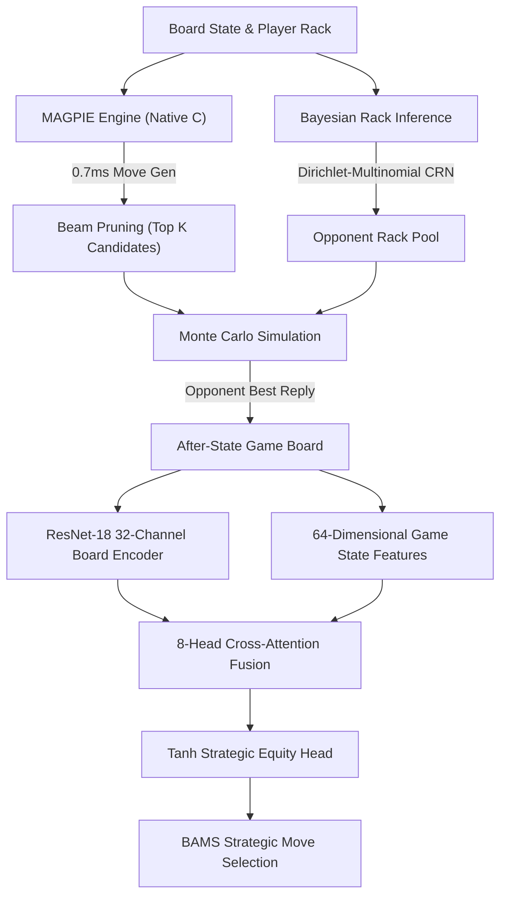

# Alphable V4

Alphable V4 is an open-source Scrabble AI engine. It combines native C move generation ([MAGPIE](https://github.com/jvc56/MAGPIE)), Bayesian opponent rack inference, and a deep value network (ResNet-18 board encoder with 8-head cross-attention over game state features) evaluated through Belief-Augmented Monte Carlo Search (BAMS).

In a 3,000-game duplicate tournament (zero tile luck), Alphable V4 achieved a 54.7% match win rate ($p = 0.00021$) against Base MAGPIE with an average score differential of +7.1 points per game.

---

## Quickstart

### Prerequisites
- OS: Linux (x86_64, aarch64) or macOS (Apple Silicon or Intel)
- Python: 3.10, 3.11, or 3.12
- Build tools: GCC or Clang, `make`, `git`

### 1. Automated installation
Run the installer from the repository root:

```bash
./install.sh
```

The script automatically:
1. Creates a Python virtual environment (`venv`).
2. Installs required packages (`torch`, `scipy`, `pandas`, `pyarrow`, `tqdm`, `pytest`).
3. Compiles the native C MAGPIE shared library (`vendor/magpie/bin/libmagpie.so` or `.dylib`).
4. Verifies the neural value network weights (`alphable_v4/models/checkpoints/v4_value_net_best.pt`).
5. Runs an initial smoke test to confirm move generation and neural inference.

### 2. Activate environment and run tests
```bash
source venv/bin/activate
pytest tests/ -v
```
All 59 unit and integration tests should pass in about 20 seconds.

### 3. Launch the Visualizer Studio (optional)
To start the interactive web interface:
```bash
./start_visualizer.sh
# or: cd visualizer && ./run.sh
```
This serves the visualizer at `http://localhost:5000` for exploring game replays, move evaluations, and tournament logs.

---

## Core CLI commands

Use `cli.py` to inspect models, play interactively, analyze positions, and run tournaments:

### 1. Inspect available models
```bash
python cli.py models
# or: ./cli.py models
```
Displays registered model presets, active checkpoint paths, search parameters, and verified tournament win rates.

### 2. Play against Alphable in the terminal
```bash
python cli.py play --model latest
```
Starts an interactive terminal Scrabble game with an ASCII board display. Type `hint` on any turn to see BAMS move recommendations, or enter plays in standard Scrabble notation (e.g. `8H CATS` or `-ABC` to exchange).

### 3. Analyze any position
```bash
# Analyze opening rack
python cli.py analyze --model latest --rack "AQRTUYZ"

# Analyze rack on a mid-game board with hook word
python cli.py analyze --model latest --rack "TRAINER" --board-word "QUIZ" --board-coord "8D"
```
Compares Base MAGPIE static equity against Alphable V4 neural BAMS valuation move by move.

### 4. Run tournaments
```bash
# Standard 100-game tournament vs Base MAGPIE
python cli.py tournament --opponent magpie --games 100

# Duplicate tournament (paired rack seeds with seat swaps to eliminate tile luck)
python cli.py tournament --opponent magpie --games 50 --duplicate

# Model vs model comparison
python cli.py tournament --model latest --opponent 5-frontiers --games 50
```

### 5. Tournament history and ledgers
```bash
# View all recorded benchmark runs
python cli.py history

# Inspect a specific run in detail
python cli.py history --show run_20261015_215837

# Compare two runs side-by-side with statistical delta
python cli.py history --compare run_20261013_143000 run_20261015_215837
```

### 6. Neural network ablation
```bash
python cli.py ablation --model latest --games 20
```
Tests identical game seeds with neural evaluation toggled on versus off to isolate the exact point contribution of the neural value network.

---

## System architecture

Alphable V4 uses a multi-stage hybrid pipeline to balance search depth with millisecond latency:



### Architecture components

1. Move generation (`alphable_v4/engine/`):
   Native C MAGPIE engine wrapped through Python `ctypes`. Generates all legal moves for any rack in 0.72 ms with CSW24 and NWL23 lexicon accuracy.

2. Belief inference (`alphable_v4/models/belief_net.py`):
   Bayesian Dirichlet-multinomial sampling from unseen bag tiles. Uses Common Random Numbers (CRN) across candidates so all moves are evaluated against identical rack pools.

3. Neural valuation (`alphable_v4/models/value_net.py`):
   32-channel board tensor encoding letter placement, tile values, blank locations, and premium squares. Combines with a 64-dimensional dense state vector (score spread, rack leaves, unseen vowel-consonant ratios, and timing indicators) through multi-head cross-attention. Evaluates in 1.96 ms for batches of 100 candidate after-states on GPU.

4. BAMS search (`alphable_v4/search/bams.py`):
   Belief-Augmented Monte Carlo Search with defensive vulnerability penalties. Includes asymmetric volatility scaling (protects leads while opening comeback lanes when trailing) and a deterministic endgame solver when nine or fewer tiles remain in the bag.

---

## Empirical benchmarks

| Benchmark | Games | Win Rate | V4 Mean Score | Opp Mean Score | Net Spread | Statistical Confidence |
| :--- | :---: | :---: | :---: | :---: | :---: | :---: |
| Duplicate (Zero Tile Luck) vs Base MAGPIE | 3,000 | 54.7% | 460.5 pts | 453.5 pts | +7.1 pts | $p = 0.00021$ ($95\%\text{ CI: } [52.2\%, 57.3\%]$) |
| Standard 1,000 Games vs Base MAGPIE | 1,000 | 54.2% | 458.1 pts | 448.3 pts | +9.8 pts | $p < 0.01$ |
| V4 Scaled Champion vs V4 Baseline (1-Ply) | 50 | 56.0% | 462.4 pts | 453.1 pts | +9.3 pts | Head-to-head validation |
| V4 vs Alphable V3 (Macondo ResNet) | 100 | 65.5% | 457.4 pts | 442.4 pts | +15.0 pts | Generational comparison |
| V4 vs Score-Greedy Baseline | 10 | 100.0% | 492.6 pts | 312.4 pts | +180.2 pts | Baseline verification |

For methodology, sample size formulas, and variance reduction proofs, see the [Statistical Significance Guide](docs/STATISTICAL_SIGNIFICANCE_AND_BENCHMARKING_GUIDE.md).

---

## Python API usage

Alphable V4 can also be used directly as a Python library:

```python
from alphable_v4.engine.magpie_bindings import MagpieEngine
from alphable_v4.engine.game_state import GameState
from alphable_v4.search.bams import BAMSSearch, BAMSConfig

# Initialize engine and search instance
engine = MagpieEngine(lexicon="CSW24")
bams = BAMSSearch.from_checkpoint(
    engine,
    checkpoint_path="alphable_v4/models/checkpoints/v4_value_net_best.pt",
    config=BAMSConfig(num_samples=32, candidate_beam=15)
)

# Set up current board position and player rack
state = GameState(rack=["A", "Q", "R", "T", "U", "Y", "Z"])

# Select best move
best_move, metadata = bams.select_move(state)
print(f"Chosen Play: {best_move} | Word Score: {best_move.score} | BAMS Score: {metadata['best_bams_score']:.2f}")
```

---

## Repository structure

```
.
├── install.sh                  # Automated environment setup and compilation script
├── requirements.txt            # Python dependencies (PyTorch, SciPy, etc.)
├── pyproject.toml              # Build config and pytest configuration
├── cli.py                      # Root command-line interface entry point
├── start_visualizer.sh         # Launcher symlink for the Visualizer Studio
│
├── alphable_v4/                # Core Python package
│   ├── cli.py                  # CLI implementation, tournament runner, and ledger
│   ├── engine/                 # MAGPIE C engine bindings and game representations
│   │   ├── game_state.py       # 15×15 Scrabble grid, CGP, tensors, and state vectors
│   │   ├── magpie_bindings.py  # ctypes wrapper for libmagpie
│   │   └── move.py             # Move dataclass, coordinates, and notation
│   ├── models/                 # Neural network architectures and checkpoints
│   │   ├── belief_net.py       # Bayesian opponent rack sampling and tracking
│   │   ├── value_net.py        # ResNet-18 and cross-attention value network
│   │   └── checkpoints/        # Saved model weights (.pt)
│   ├── platform/               # Match runners and platform adapters
│   │   ├── eval.py             # Match and tournament simulation loops
│   │   └── woogles_bot.py      # Woogles.io bot interface
│   ├── search/                 # Move selection and tree search
│   │   └── bams.py             # Belief-Augmented Monte Carlo Search (BAMS)
│   └── training/               # Distillation and RL pipelines
│       ├── build_belief_dataset.py
│       ├── build_value_dataset.py
│       ├── collect_woogles.py
│       ├── macondo_distill.py
│       ├── optimize_hyperparams.py
│       ├── parse_gcg.py
│       ├── train_belief.py
│       ├── train_rl.py
│       └── train_value.py
│
├── data/                       # Datasets, logs, and benchmark records
│   ├── belief/                 # Belief network training data
│   ├── tournaments/            # Tournament game telemetry and history ledger
│   └── value/                  # Value network training datasets
│
├── resources/                  # Official tournament lexicons
│   ├── CSW24.txt               # Collins Scrabble Words 2024
│   └── NWL23.txt               # NASPA Word List 2023
│
├── vendor/
│   └── magpie/                 # Native C MAGPIE move generation engine
│       └── bin/libmagpie.so    # Compiled shared library
│
├── visualizer/                 # Alphable Visualizer Studio
│   ├── backend/                # Flask API server
│   ├── frontend/               # React analysis interface
│   └── run.sh                  # Studio launcher script
│
├── docs/                       # Project documentation
│   ├── GETTING_STARTED.md      # Setup walkthrough and verification
│   ├── USER_GUIDE.md           # CLI commands and configuration guide
│   ├── ARCHITECTURE.md         # Technical specification of BAMS and networks
│   ├── MODELS_AND_RESOURCES.md # Model configurations and parameters
│   ├── TOURNAMENT_BENCHMARKS_AND_COMMAND_MANUAL.md # Historical tournament logs
│   ├── STATISTICAL_SIGNIFICANCE_AND_BENCHMARKING_GUIDE.md # Duplicate tournament methodology
│   └── ROADMAP_TO_58_PERCENT.md # Architectural roadmap
│
└── tests/                      # Automated test suite
    ├── engine/                 # MAGPIE bindings and game state tests
    ├── models/                 # Neural tensor and shape tests
    ├── platform/               # CLI and evaluation runner tests
    ├── search/                 # BAMS move selection and endgame tests
    └── training/               # Dataset extraction and RL tests
```

---

## Documentation index

Alphable V4 documentation follows the [Diátaxis](https://diataxis.fr/) framework:

| Category | Document | Description |
|---|---|---|
| Tutorial | [GETTING_STARTED.md](docs/GETTING_STARTED.md) | Step-by-step setup walkthrough, manual fallback, and initial test run. |
| How-to | [USER_GUIDE.md](docs/USER_GUIDE.md) | CLI commands, parameter customization, and evaluation workflows. |
| How-to | [STATISTICAL_SIGNIFICANCE_AND_BENCHMARKING_GUIDE.md](docs/STATISTICAL_SIGNIFICANCE_AND_BENCHMARKING_GUIDE.md) | Duplicate tournament methodology, sample sizes, and significance testing. |
| Reference | [TOURNAMENT_BENCHMARKS_AND_COMMAND_MANUAL.md](docs/TOURNAMENT_BENCHMARKS_AND_COMMAND_MANUAL.md) | Historical benchmark logs and command reference. |
| Reference | [MODELS_AND_RESOURCES.md](docs/MODELS_AND_RESOURCES.md) | Checkpoints, tensor shapes, search presets, and file sizes. |
| Reference | [ARCHITECTURE.md](docs/ARCHITECTURE.md) | Mathematical specifications for BAMS, tensors, and neural networks. |
| Explanation | [ROADMAP_TO_58_PERCENT.md](docs/ROADMAP_TO_58_PERCENT.md) | Strategic analysis and scaling plans. |
| Explanation | [PHASE0_RESULTS.md](docs/PHASE0_RESULTS.md) to [PHASE4_RESULTS.md](docs/PHASE4_RESULTS.md) | Experimental records, ablations, and design rationale across development phases. |

---

## License

Alphable V4 is open source under the MIT License. The bundled MAGPIE engine is licensed separately under its own open-source terms.
