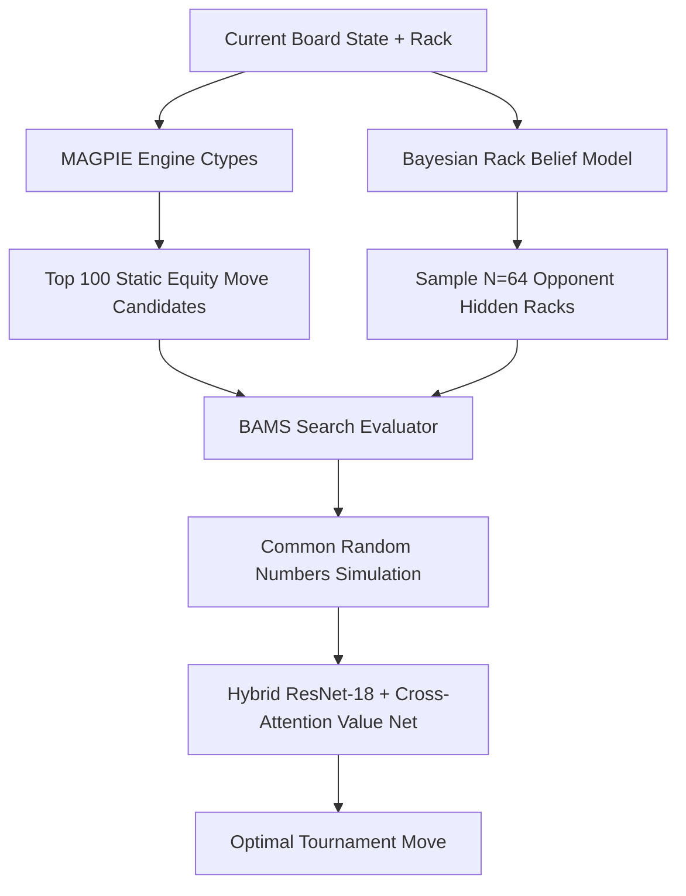

# Alphable V4: System Architecture

Alphable V4 is a tournament Scrabble engine that combines four subsystems:
1. **MAGPIE C-Native Engine**: Fast move generation and KLV leave valuation via [`vendor/magpie/bin/libmagpie.so`](file:///home/targed/Documents/Git/Alphable/vendor/magpie/bin/libmagpie.so).
2. **Belief-Augmented Monte Carlo Search (BAMS)**: Opponent hidden-rack inference with Common Random Numbers (CRN) variance reduction in [`alphable_v4/search/bams.py`](file:///home/targed/Documents/Git/Alphable/alphable_v4/search/bams.py).
3. **Hybrid ResNet-18 and Cross-Attention Value Network**: 32-channel spatial board tensor cross-attended over a 64-dimensional dynamic state vector in [`alphable_v4/models/value_net.py`](file:///home/targed/Documents/Git/Alphable/alphable_v4/models/value_net.py).
4. **Macondo Ground-Truth Equity Distillation**: Continuous deficit labeling anchored against grandmaster-analyzed positions in [`alphable_v4/training/macondo_distill.py`](file:///home/targed/Documents/Git/Alphable/alphable_v4/training/macondo_distill.py).

---

## 1. System Pipeline



---

## 2. Representation Specifications

### Board Tensor (32 Channels, 15x15 Grid)
- **Channels 0-25:** One-hot indicator planes for English alphabet letters `A` through `Z`.
- **Channel 26:** Designated blank tile indicator plane, identifying blank tiles assigned to letters.
- **Channels 27-30:** Dynamic premium square masks (`DL`, `TL`, `DW`, `TW`), active (1.0) when square is unoccupied and zeroed (0.0) once covered by a tile.
- **Channel 31:** Current player rack overlap / hook plane, marking board letters matching active rack tiles for bingo anchor detection.

### Game State Vector (64 Dimensions)
- **Dims 0-25:** Tile counts for `A` through `Z` on current player rack.
- **Dim 26:** Blank tile count on current player rack.
- **Dim 27:** Normalized score differential `(our_score - opp_score) / 500.0`.
- **Dim 28:** Normalized remaining bag tile count `bag_count / 100.0`.
- **Dims 29-35:** Strategic leave metrics (leave length / 7.0, vowel ratio, consonant ratio, blank flag, 'S' flag, duplicate penalty, bingo/out flag).
- **Dims 36-61:** Unseen tile ratios for `A` through `Z` relative to English Scrabble pool.
- **Dim 62:** Unseen blank tile ratio `unseen_blanks / 2.0`.
- **Dim 63:** Bayesian rack belief confidence / entropy score.

---

## 3. Directory Layout

The repository is structured with the core Python package at the root:

```
.
├── cli.py                  # Root CLI entry point
├── pyproject.toml          # Package configuration and build dependencies
├── requirements.txt        # Runtime and training dependencies
├── README.md               # Project overview and quickstart
├── alphable_v4/            # Core engine package
│   ├── engine/             # Board representation and C engine bindings
│   │   ├── game_state.py   # 15x15 board, CGP serialization, 32-ch tensor, 64-dim vector
│   │   ├── magpie_bindings.py # ctypes wrapper for libmagpie.so
│   │   └── move.py         # Move dataclass, coordinate/UCGI parsers
│   ├── models/             # Neural network architectures and checkpoints
│   │   ├── belief_net.py   # Bayesian and neural opponent rack inference
│   │   ├── checkpoints/    # Trained weights (v4_value_net_best.pt, etc.)
│   │   └── value_net.py    # Hybrid ResNet-18 + cross-attention network
│   ├── platform/           # Bot clients and evaluation harness
│   │   ├── eval.py         # Head-to-head match harness
│   │   └── woogles_bot.py  # WebSocket bot client with multi-lexicon support
│   ├── search/             # Monte Carlo search and rollouts
│   │   └── bams.py         # Belief-Augmented Monte Carlo Search
│   └── training/           # Data ingestion, distillation, and training pipelines
│       ├── build_belief_dataset.py
│       ├── build_value_dataset.py
│       ├── collect_woogles.py
│       ├── macondo_distill.py
│       ├── optimize_hyperparams.py
│       ├── parse_gcg.py
│       ├── train_belief.py
│       ├── train_rl.py
│       └── train_value.py
├── data/                   # Data logs, parsed games, and tournament outputs
│   └── tournaments/        # Tournament telemetry and historical ledger
├── docs/                   # System architecture and benchmarking documentation
├── resources/              # Lexicons (CSW24.txt, NWL23.txt)
├── tests/                  # Pytest verification suites
│   ├── engine/             # Parity and latency verification suites
│   ├── models/             # Neural network architecture and tensor unit tests
│   ├── platform/           # Evaluation harness and CLI tests
│   ├── search/             # BAMS search verification tests
│   └── training/           # Data ingestion and loss calculation tests
├── vendor/
│   └── magpie/             # MAGPIE C engine (compiled to bin/libmagpie.so)
└── visualizer/             # Web-based game visualizer and match viewer
```

### Key Module References
- [`alphable_v4/engine/game_state.py`](file:///home/targed/Documents/Git/Alphable/alphable_v4/engine/game_state.py): Board representation, tensor creation, and move application.
- [`alphable_v4/engine/magpie_bindings.py`](file:///home/targed/Documents/Git/Alphable/alphable_v4/engine/magpie_bindings.py): Low-level ctypes interface to the compiled C engine.
- [`alphable_v4/models/value_net.py`](file:///home/targed/Documents/Git/Alphable/alphable_v4/models/value_net.py): ResNet-18 spatial encoder and cross-attention value predictor.
- [`alphable_v4/models/belief_net.py`](file:///home/targed/Documents/Git/Alphable/alphable_v4/models/belief_net.py): Bayesian unseen tile tracker and negative-inference belief distribution.
- [`alphable_v4/search/bams.py`](file:///home/targed/Documents/Git/Alphable/alphable_v4/search/bams.py): Candidate pruning, Monte Carlo rollout evaluator, and exact endgame solver.
