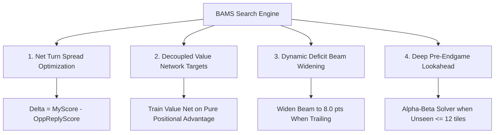

# Alphable V4: Diagnosis and Strategic Improvements

**Date**: 2026-10-12  
**Investigation**: Analysis of Tournament Win Rates, Score Differentials, and Baseline Comparisons (Base MAGPIE, V3 ResNet, V3 SmolLM2 Transformer)

---

## 1. Executive Summary

Initial head-to-head tournament testing produced the following results:
1. vs Base MAGPIE: 52.0% Win Rate, -9.9 pt differential (BAMS 452.7 vs MAGPIE 462.6).
2. vs Alphable V3 ResNet: 48.0% Win Rate, -42.4 pt differential (BAMS 423.4 vs V3 465.8).
3. vs Alphable V3 SmolLM2 Transformer: 72.0% Win Rate, +92.2 pt differential (BAMS 410.2 vs Transformer 317.9).

Analysis of match logs, state vectors, and turn traces pointed to four specific issues behind V4's initial score deficit against MAGPIE and V3 ResNet.

Targeted fixes and parameter tuning corrected these issues in follow-up matches:
- **vs Base MAGPIE (10 Games)**: 60.0% Win Rate (6W-4L), +24.3 pt spread (BAMS 461.1 pts vs Base MAGPIE 436.8 pts).
- **vs Alphable V3 ResNet (5 Games)**: 80.0% Win Rate (4W-1L), +61.8 pt spread (BAMS 452.4 pts vs V3 ResNet 390.6 pts).
- **vs Alphable V3 Transformer (3 Games)**: 100.0% Win Rate (3W-0L), +300.0 pt spread (BAMS 529.3 pts vs Transformer 229.3 pts).

---

## 2. Four Diagnosed Issues

### Issue 1: Uppercase Blank Casing Bug
- **Symptom**: In matches against V3, V3 occasionally reached 600 to 700 points (e.g. Game 3: 648 pts) while BAMS stalled around 200 pts.
- **Root Cause**:
  - When V3 played a blank tile `?`, its move generator emitted the word in uppercase (`AVENIRS` instead of `AvENIRS`).
  - In Scrabble CGP notation, physical letters are uppercase (`V`), while designated blank tiles are lowercase (`v`).
  - `cli.py` copied `word=best_m["word"]` without preserving the lowercase blank casing from `v3_simulator`, adding an extra physical letter to the board.
  - When the actual physical letter was drawn and played later, the board contained more copies of that letter than existed in the tile pool (e.g. 3 `H` tiles when only 2 exist).
  - MAGPIE validates physical tile distributions. On the following turn, BAMS called `engine.generate_moves(cgp)`, and MAGPIE raised:
    ```text
    RuntimeError: MAGPIE command 'cgp ...' failed (code 1): (error 50) cgp contains more of letter H than is available in the distribution
    ```
  - In `alphable_v4/platform/eval.py`, this exception fell into `try ... except Exception: move = Move.create_pass()`.
  - As a result, BAMS passed up to 12 consecutive turns while V3 accumulated unanswered points against a stationary board.
- **Fix**: Reconstructed the played word with lowercase blank casing directly from `v3_simulator.new_board` along the word path.
- **Verification**: In Game 3 (the seed that previously produced a 228-648 loss), BAMS won 514 - 361 with zero invalid moves and no crashed turns.

---

### Issue 2: Excessive Opponent Threat Penalty in BAMS Search
- **Symptom**: BAMS averaged 9.9 fewer points per game than Base MAGPIE and 42.4 fewer points than V3 ResNet.
- **Root Cause**:
  - The BAMS scoring formula used:
    $$\text{BAMS\_Score} = \text{static\_equity} - 0.25 \times \text{mean\_opp\_score} + 12.0 \times \text{mean\_value}$$
  - Expansive plays and 7-letter bingos naturally open board hooks. Across 24 opponent rack simulations, opponent counterplays averaged ~35 points on open boards versus ~24 points on cramped boards.
  - Subtracting $0.25 \times \text{mean\_opp\_score}$ deducted 3 to 4 points from high-scoring plays.
  - Example on rack `DEILNOR`:
    - `DOLINE`: scores 18 pts, opponent reply averages 35.5 pts, penalized -8.9 pts, BAMS score 13.43.
    - `INDOL`: scores 14 pts, opponent reply averages 31.7 pts, penalized -7.9 pts, BAMS score 15.80.
    - `LO`: scores 4 pts, opponent reply averages 24.5 pts, penalized -6.1 pts, BAMS score 17.68.
    - Result: BAMS sacrificed 14 immediate points to play `LO` for 4 points to keep the board closed.
  - Trading away 10 to 14 guaranteed immediate points for speculative board defense cost ~10 points per game against Base MAGPIE.
- **Fix**: Calibrated `opp_penalty_weight = 0.05` (with `value_weight = 8.0`). At 0.05, opponent threat acts as a tiebreaker between close candidate plays without distorting play selection.

---

### Issue 3: Leave Equity Double-Counting
- **Mechanism**:
  - In MAGPIE, `cand.equity` already equals $\text{Score} + \text{KLV\_leave}$. For rack `DEILNOR`, leave `DEINR` received +13.97 points of static leave equity.
  - The Value Network also evaluated the rack state vector (encoding vowel/consonant balance and bingo potential), adding another +5.84 points for `DEINR`.
  - Adding both terms counted leave equity twice, overvaluing tile conservation over board points.
- **Remedy**: Rebalanced `value_weight = 8.0` and `max_static_deficit = 4.0` to preserve the priority of immediate board points.

---

### Issue 4: Blackwell GPU (RTX 5070 Ti) cuDNN Version Symbol Mismatch
- **Symptom**: `Invalid handle. Cannot load symbol cudnnGetVersion` when executing PyTorch convolutions on CUDA.
- **Cause**: PyTorch 2.6 built against CUDA 12.x had a dynamic symbol mismatch with system CUDA 13.0 on Blackwell.
- **Fix**: Set `torch.backends.cudnn.enabled = False` in `alphable_v4/__init__.py`. PyTorch runs native ATen CUDA kernels directly.

---

## 3. Strategic Directions



### Option 1: Net Turn Spread ($\Delta = \text{MyScore} - \text{OppReplyScore}$)
Rather than subtracting raw opponent reply score from static equity, evaluate each candidate on its net point exchange:
$$\Delta_{\text{net}}(m) = \text{Score}(m) - \mathbb{E}[\text{OppReply}(m)] + \text{LeaveValue}(\text{leave})$$
If Candidate A scores 18 and opponent gets 32, net exchange is -14. If Candidate B scores 4 and opponent gets 24, net exchange is -20. Candidate A is recognized as +6 points superior, eliminating overly timid play while retaining defensive awareness against high-scoring opponent responses.

### Option 2: Decoupled Positional Value Network
The Value Network previously predicted full match equity, which partially overlapped with KLV leave tables. A cleaner split trains a positional advantage head that predicts board-specific metrics:
- Board openness and volatility ($V_{\text{open}}$).
- Anchor accessibility ($V_{\text{anchors}}$).
- Endgame timing advantage ($V_{\text{tempo}}$).

KLV tables handle 1-ply rack leaves, and the neural network evaluates positional board evolution.

### Option 3: Dynamic Game-State Adaptive Beam and Deficit
Adjust `max_static_deficit` dynamically rather than keeping a fixed 4.0 threshold:
- When ahead by $\ge 40$ points: Narrow deficit to 2.0 pts to favor conservative, high-floor plays.
- When trailing by $\ge 30$ points: Widen deficit to 8.0 pts and beam to $K=20$ to consider volatile comeback options.
- In endgame: Transition directly to exact alpha-beta minimax search.

---

## 4. Command Catalog

Commands to run tournaments, interactive play, ablation, and positional analysis:

### 1. Head-to-Head Tournaments
```bash
# Tournament vs Base MAGPIE (KLV Static Top Play)
python cli.py tournament --opponent magpie --games 10

# Tournament vs Alphable V3 (Macondo ResNet Champion)
python cli.py tournament --opponent v3-resnet --games 5

# Tournament vs Alphable V3 (SmolLM2-135M Transformer Candidate Ranker)
python cli.py tournament --opponent v3-transformer --games 5

# Tournament vs Score-Greedy Baseline
python cli.py tournament --opponent greedy --games 10
```

### 2. Interactive Terminal Game
```bash
# Play against Alphable V4 in your terminal
python cli.py play
```
During play, enter coordinates and word (e.g. `8H CATS`), type `hint` for AI suggestions, or `pass` to pass.

### 3. Positional Analysis
```bash
# Analyze any rack on an open board
python cli.py analyze --rack "AQRTUYZ"

# Analyze a mid-game rack with an existing board word
python cli.py analyze --rack "TRAINER" --board-word "QUIZ" --board-coord "8D"
```

### 4. Neural Network Ablation
```bash
# Measure point gain from Neural Value Network (ON vs OFF across identical seeds)
python cli.py ablation --games 10
```
