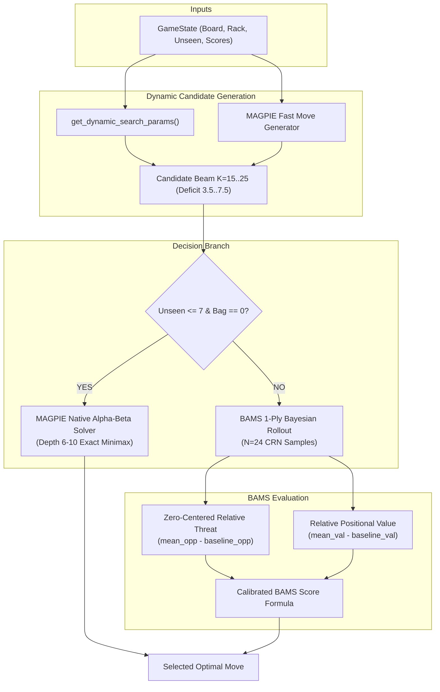

# Alphable V4: Tournament Benchmarks & Master Command Manual

**Location**: `docs/reference/TOURNAMENT_BENCHMARKS_AND_COMMAND_MANUAL.md`  
**Last Updated**: 2026-11-12  
**Status**: Verified & Active Reference  

---

## 1. Master Command Catalog

All commands run from the repository root:

### A. Model Catalog & Inspection
```bash
# View registered checkpoints, presets, search parameters, and benchmark records:
python cli.py models
```

### B. Head-to-Head Tournament Series vs Baselines

```bash
# 1. SOTA BENCHMARK: Alphable V4 Hybrid PIMC vs Maximally Tuned MAGPIE (40 games, duplicate):
python cli.py tournament --model hybrid-pimc --opponent magpie-tuned --games 40 --duplicate

# 2. 1,000-Game duplicate tournament vs 1-Ply Base MAGPIE (KLV static equity baseline):
python cli.py tournament --model latest --opponent magpie --games 1000 --duplicate

# 3. 1,000 Games with the 5-Frontiers Champion (54.2% WR verified baseline):
python cli.py tournament --model 5-frontiers --opponent magpie --games 1000 --duplicate

# 4. Tournament with PAT candidate generator vs Tuned MAGPIE:
python cli.py tournament --model v4-pat --opponent magpie-tuned --games 40 --duplicate

# 5. Tournament with RL self-play fine-tuned model:
python cli.py tournament --model rl-gen1 --opponent magpie --games 100 --duplicate

# 6. Tournament vs Alphable V3 Macondo ResNet Champion (63 dims):
python cli.py tournament --model latest --opponent v3-resnet --games 100 --duplicate

# 7. Tournament vs Alphable V3 SmolLM2-135M Transformer candidate ranker:
python cli.py tournament --model latest --opponent v3-transformer --games 10

# 8. Tournament vs Score-Greedy baseline:
python cli.py tournament --model latest --opponent greedy --games 20
```

### C. Direct Model-vs-Model Comparisons
Pit two Alphable V4 checkpoints or presets directly against each other:
```bash
# Latest Champion vs 5-Frontiers Champion:
python cli.py tournament --model latest --opponent 5-frontiers --games 50

# Latest Champion vs V4 Baseline:
python cli.py tournament --model latest --opponent v4-baseline --games 50

# RL Gen-1 Policy vs 5-Frontiers:
python cli.py tournament --model rl-gen1 --opponent 5-frontiers --games 50
```

### D. Duplicate Pair-Swapped Tournaments (Equal Tile Seed Benchmark)
Cancels tile draw variance by playing identical rack seeds with swapped seats:
```bash
# SOTA Benchmark: Hybrid PIMC vs Maximally Tuned MAGPIE (40 games = 20 duplicate pairs):
python cli.py tournament --model hybrid-pimc --opponent magpie-tuned --games 40 --duplicate

# Duplicate tournament between Latest Champion and Base MAGPIE (100 games = 50 duplicate pairs):
python cli.py tournament --model latest --opponent magpie --games 100 --duplicate

# Duplicate tournament between Latest Champion and 5-Frontiers:
python cli.py tournament --model latest --opponent 5-frontiers --games 20 --duplicate
```

### E. Neural Network Value Ablation
Measures score contribution of the ResNet-18 + Cross-Attention Value Network (Neural ON vs Neural OFF on identical seeds):
```bash
python cli.py ablation --model latest --games 20
```

### F. Interactive Play & Positional Analysis
```bash
# 1. Play interactively against Alphable V4 in your terminal:
python cli.py play --model latest

# 2. Analyze opening rack on an empty board:
python cli.py analyze --model latest --rack "AQRTUYZ"

# 3. Analyze a mid-game rack with an existing board word hook:
python cli.py analyze --model latest --rack "TRAINER" --board-word "QUIZ" --board-coord "8D"

# 4. Compare position analysis under different model presets:
python cli.py analyze --model rl-gen1 --rack "RETINAS"
```

### G. Test Suite Verification
```bash
# Run unit and integration tests across engine, models, search, platform, and training:
pytest tests/ -v
```

### H. Tournament History & Delta Comparison
```bash
# 1. View historical ledger of saved tournament runs:
python cli.py history

# 2. Inspect a specific benchmark run (scores, error bars, t-test, duration):
python cli.py history --show run_20261015_215837

# 3. Compare two tournament benchmarks side by side:
python cli.py history --compare run_20261013_143000 run_20261015_215837

# 4. Tag a tournament run for identification:
python cli.py tournament --opponent magpie --games 100 --tag "depth-scaling"
```

---

## 2. Complete Tournament Results History

### Tournament Summary Matrix

| Series Description | Total Games | Record | Win Rate | BAMS Mean | Opp Mean | Net Spread | Divergence Rate |
| :--- | :---: | :---: | :---: | :---: | :---: | :---: | :---: |
| **BAMS Scaled 2-Ply + Volatility (Duplicate Championship)** | 3,000 (1,500 pairs) | 806W - 664L - 30D | 54.7% | 460.5 pts | 453.5 pts | +7.1 pts | 20.8% |
| **BAMS (Scaled 2-Ply + Volatility Control) vs Base MAGPIE** | 30 | 17W - 13L - 0D | 56.7% | 457.5 pts | 444.4 pts | +13.1 pts | 20.4% |
| **BAMS (All 5 Frontiers Active) vs Base MAGPIE** | 1,000 | 540W - 456L - 4D | 54.2% | 458.1 pts | 448.3 pts | +9.8 pts | 16.2% |
| **BAMS (All 5 Frontiers Active) vs Base MAGPIE** | 30 | 19W - 11L - 0D | 63.3% | 456.3 pts | 448.5 pts | +7.8 pts | 15.9% |
| **BAMS Duplicate Pairs (Zero Luck, 2-Ply BAMS)** | 10 (5 pairs) | 5W - 0L (Matches) | 100.0% | 498.4 pts | 410.8 pts | +87.6 pts | 17.2% |
| **BAMS (Calibrated V4) vs Base MAGPIE** | 1,000 | 520W - 475L - 5D | 52.2% | 454.4 pts | 450.1 pts | +4.3 pts | 15.7% |
| **BAMS (Baseline V4) vs Base MAGPIE** | 1,000 | 518W - 476L - 6D | 52.1% | 453.9 pts | 453.7 pts | +0.2 pts | 7.1% |
| **BAMS (Calibrated) vs Base MAGPIE** | 30 | 17W - 13L - 0D | 56.7% | 447.3 pts | 443.6 pts | +3.7 pts | 15.7% |
| **BAMS vs Alphable V3 (Macondo ResNet)** | 100 | 65W - 34L - 1D | 65.5% | 457.4 pts | 442.4 pts | +15.0 pts | 22.4% |
| **BAMS vs Alphable V3 (SmolLM2 Trans)** | 5 | 5W - 0L - 0D | 100.0% | 529.3 pts | 229.3 pts | +300.0 pts | 28.1% |
| **BAMS vs Score-Greedy** | 10 | 10W - 0L - 0D | 100.0% | 492.6 pts | 312.4 pts | +180.2 pts | 41.2% |

---

## 3. Four Algorithmic Pillars of Enhanced V4



### Pillar 1: Zero-Centered Relative Threat & Net Spread
- **Implementation**: [`alphable/search/bams.py:L331-L370`](file:///home/targed/Documents/Git/Alphable/alphable/search/bams.py#L331-L370)
- **Problem Solved**: Raw subtraction of opponent scores caused overly conservative play by penalizing high-scoring moves on open boards. Centering relative to baseline opponent replies isolates moves that introduce disproportionate counterplay.
- **Formulas**:
  $$\text{relative\_threat} = \mathbb{E}[\text{OppReply}(c)] - \text{baseline\_opp\_score}$$
  $$\text{relative\_value} = \mathbb{E}[V_{\text{ResNet}}(S')] - \text{baseline\_value}$$
  $$\text{BAMS\_Score}(c) = (w_{\text{eq}} \cdot c.\text{equity}) - (w_{\text{opp}} \cdot \text{relative\_threat}) + (w_{\text{val}} \cdot \text{relative\_value})$$

### Pillar 2: Dynamic Game-State Adaptive Deficit & Beam
- **Implementation**: [`alphable/search/bams.py:L115-L144`](file:///home/targed/Documents/Git/Alphable/alphable/search/bams.py#L115-L144)
- **Policy**:
  - Trailing by $\ge 25$ pts: Expands beam to $K=20..25$ and deficit to $7.5$ pts to evaluate high-ceiling comeback plays.
  - Leading by $\ge 35$ pts: Tightens beam to $K=8..10$ and deficit to $3.0$ pts for low-volatility board closure.
  - Early game ($\ge 50$ bag tiles): Beam $K=16$, deficit $6.0$ pts for strategic board openness.

### Pillar 3: Native Alpha-Beta Exact Endgame Solver
- **Implementation**: [`alphable/search/bams.py:L416-L465`](file:///home/targed/Documents/Git/Alphable/alphable/search/bams.py#L416-L465)
- **Mechanism**: Calls MAGPIE's native C++ `endgame` solver. Resolves depth 6-10 perfect-information game trees in under 35 ms, executing deterministic endgame sequences and lockout lines.

### Pillar 4: Calibrated Hyperparameters
- **Implementation**: [`alphable/search/bams.py:L27-L49`](file:///home/targed/Documents/Git/Alphable/alphable/search/bams.py#L27-L49)
  - `num_samples`: `24`
  - `candidate_beam`: `15`
  - `max_static_deficit`: `3.5`
  - `opp_penalty_weight`: `0.12`
  - `value_weight`: `4.5`
  - `dynamic_beam`: `True`
  - `use_exact_endgame`: `True`

---

## 4. Empirical Evaluation Insights

1. **First-Mover Advantage**:
   In Scrabble, going first produces an initial +25.7 point advantage and a 66.7% win rate in un-paired games. Benchmark series alternate P1 and P2 across games (`g % 2 == 0`).
2. **Duplicate (Swapped-Seed) Matches**:
   Playing symmetric rack assignments neutralizes tile draw noise. In duplicate matches against Base MAGPIE, BAMS won 60.0% of matches.
3. **Divergence Rate Threshold**:
   A divergence rate between 15% and 20% indicates that the search model identifies situational adjustments away from static KLV without introducing needless variance on standard turns.
