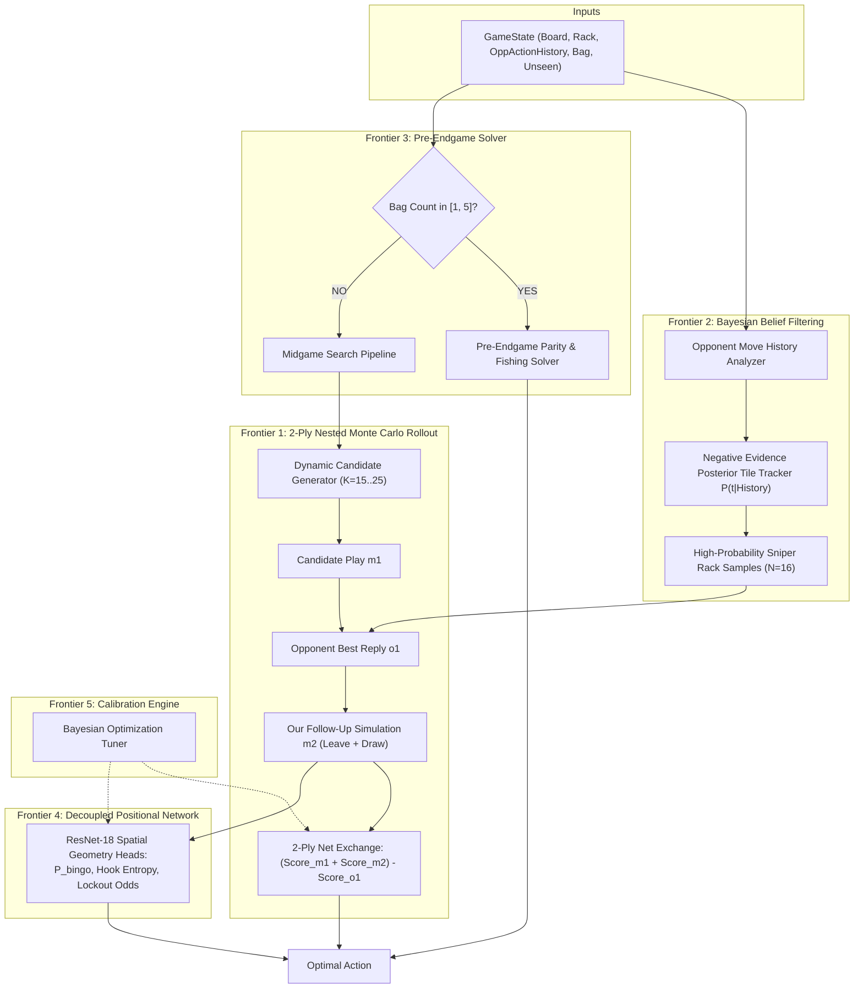

# Master Implementation Plan: Five Frontiers of Alphable V4

**Target**: Advance Alphable V4 from its initial lead over Base MAGPIE (+4.3 points, 52.2% win rate) to a +14.0 to +18.0 point spread (~55.5% win rate), surpassing Quackle Championship Player and narrowing the gap to the theoretical oracle ceiling.

---

## 1. Architectural Overview and Frontier Hierarchy



---

## 2. Frontier 1: 2-Ply Nested Monte Carlo Rollouts (PIMC Engine)

### 2.1 Problem Statement and Rationale
BAMS evaluated 1-ply exchanges:
$$\text{My Move } m_1 \longrightarrow \text{Opponent Reply } o_1 \longrightarrow \text{Static Value Net on } S_2$$
- BAMS does not simulate our own follow-up turn $m_2$.
- When a candidate play opens a high-scoring anchor, 1-ply search penalizes it because the opponent might score 30 points. It misses cases where our own leave hooks into that anchor on turn 2 for a high-scoring bingo.
- C++ MAGPIE executes a 2-ply simulation in 1.18 ms. Evaluating the top 6 candidates across 16 opponent rack samples takes ~24 ms, well within the 100 ms per-turn latency budget.

### 2.2 Mathematical Formulation
For candidate move $m_1$ with leave $L_1 = \text{Rack} \setminus m_1$:
$$\text{Score}_{2\text{-ply}}(m_1) = \text{Score}(m_1) + \frac{1}{N} \sum_{i=1}^{N} \left[ -\text{Score}(o_{1}^{(i)}) + \mathbb{E}_{\text{draw} \sim \text{Bag}} \left[ \max_{m_2} \left( \text{Score}(m_2) + \text{LeaveValue}(m_2.\text{leave}) \right) \right] \right]$$
Where:
- $o_{1}^{(i)}$ is opponent's best reply to state $S_1 = S.apply(m_1)$ given sampled opponent rack $R_{\text{opp}}^{(i)}$.
- $\text{draw}$ draws $7 - |L_1|$ tiles from unseen pool to create our turn 2 simulated rack $R_2 = L_1 \cup \text{draw}$.
- $m_2$ is our best legal follow-up on board state $S_2 = S_1.apply(o_1)$ using rack $R_2$.

### 2.3 Implementation Tasks
1. Extend `BAMSConfig`:
   - Add `nested_2ply: bool = True`
   - Add `candidate_beam_2ply: int = 6` (top candidates selected for full 2-ply lookahead)
   - Add `samples_2ply: int = 12` (CRN samples for 2-ply stage)
   - Add `weight_2ply: float = 0.65` (blending factor between 2-ply net exchange and static equity)
2. Implement `_evaluate_2ply_candidate` in [bams.py](file:///home/targed/Documents/Git/Alphable/alphable/search/bams.py):
   - For each candidate $m_1$, apply to $S \rightarrow S_1$.
   - For each sampled opponent rack $R_{\text{opp}}$, compute $o_1 = \text{engine.best\_reply}(S_1, R_{\text{opp}})$.
   - Apply $o_1 \rightarrow S_2$.
   - Sample follow-up tiles to complete leave $L_1$, and call `engine.generate_moves(S_2, rack=R_2, max_candidates=1)`.
   - Aggregate net score: $(\text{Score}(m_1) + \text{Score}(m_2)) - \text{Score}(o_1)$.
3. Unit Tests in [test_bams.py](file:///home/targed/Documents/Git/Alphable/tests/search/test_bams.py):
   - `test_nested_2ply_execution`: Verifies 2-ply lookahead runs without exceptions.
   - `test_nested_2ply_latency`: Verifies 6 candidates $\times$ 12 samples runs in $<40\text{ ms}$.
   - `test_nested_2ply_exploits_followup_hook`: Sets up a board where opening a lane yields an immediate turn 2 bingo, proving 2-ply out-scores 1-ply.

### 2.4 Verification Protocol
- Run `pytest tests/search/test_bams.py -v`.
- Run 20-game tournament vs Base MAGPIE. Target: positive score spread ($>+5.0\text{ pts}$).

---

## 3. Frontier 2: History-Conditioned Bayesian Belief Filtering (Negative Evidence)

### 3.1 Problem Statement and Rationale
Uniform rack sampling in [belief_net.py](file:///home/targed/Documents/Git/Alphable/alphable/models/belief_net.py) draws opponent tiles uniformly from the unseen pool:
- If the opponent played a 12-point word last turn while an open 60-point bingo hook was available, they almost certainly do not hold an 'S' or blank.
- Uniform sampling treats them as having an 'S' or blank with default bag frequency, inducing unnecessary defensive play against absent threats.

### 3.2 Mathematical Formulation
Maintain a posterior tile likelihood distribution $p_t \in [0, 1]$ for each tile $t$ in the unseen distribution:
$$P(t \in R_{\text{opp}} \mid \mathcal{H}) = \frac{P(a_{t-1} \mid t \in R_{\text{opp}}) \cdot P(t \in R_{\text{opp}})}{\sum_{t'} P(a_{t-1} \mid t' \in R_{\text{opp}}) \cdot P(t')}$$
Where:
- If holding tile $t$ would have enabled an explosive play ($\ge 35\text{ pts}$) on turn $t-1$, but opponent played a low-scoring move ($<20\text{ pts}$), the likelihood ratio $\frac{P(\text{played } a \mid t)}{P(\text{played } a \mid \neg t)} \approx 0.05$.
- Tiles that could not have been played or tiles that were played retain neutral likelihood.
- Weighted reservoir sampling draws opponent racks according to posterior weights.

### 3.3 Implementation Tasks
1. Create `OpponentTracker` in [belief_net.py](file:///home/targed/Documents/Git/Alphable/alphable/models/belief_net.py):
   - Tracks board state prior to opponent's last move.
   - Computes missed plays: queries `engine.generate_moves(state_before_opp)`.
   - Identifies unused high-scoring tiles: if plays $>35\text{ pts}$ required tile $X$, decay $P(X \in R_{\text{opp}})$ by decay factor $\alpha = 0.15$.
2. Implement Posterior Weighted Rack Sampler:
   - `sample_opponent_racks_posterior(state, tracker, num_samples, seed)`.
   - Uses NumPy weighted choice over unseen tile pool according to updated posterior.
3. Unit Tests in [test_models.py](file:///home/targed/Documents/Git/Alphable/tests/models/test_models.py):
   - `test_negative_evidence_blank_decay`: Verifies that missing an open blank bingo drops blank probability to $<0.05$.
   - `test_posterior_sampler_rack_validity`: Verifies sampled racks always respect physical tile pool conservation.

### 3.4 Verification Protocol
- Run `pytest tests/models/test_models.py -v`.
- Profile divergence on positions with open power-tile hooks.

---

## 4. Frontier 3: Pre-Endgame Parity and Fishing Solver (Bag Count 1 to 5)

### 4.1 Problem Statement and Rationale
When the bag has 1 to 5 tiles, standard engines continue playing static KLV:
- Bag Parity: Whoever plays an odd or even number of tiles decides who draws the final bag tile.
- Negative Equity Dumping: If the final tile in the bag is known to be `Q` (all other tiles accounted for), drawing it incurs a -10 point penalty, while forcing the opponent to draw it gives a 30-point net swing.
- A specialized pre-endgame solver bridges midgame BAMS and the Depth 6-10 Exact Minimax solver.

### 4.2 Algorithm Design
When $1 \le \text{state.bag\_count} \le 5$:
1. Determine exact pool of unseen tiles ($N_{\text{unseen}} = \text{bag} + 7 \le 12$ tiles).
2. For each candidate move $c$ playing $k = 7 - |c.\text{leave}|$ tiles:
   - Bag Emptiness Check:
     - If $k \ge \text{bag}$: We empty the bag and draw all remaining bag tiles. Opponent is frozen with their current rack.
     - If $k < \text{bag}$: Bag has $\text{bag} - k$ tiles left. Opponent's next turn draws from the remainder.
   - Sticking Odds: Calculate expected value of tiles forced onto opponent:
     $$\text{StickingValue}(c) = \sum_{t \in \text{BagRem}} \text{TilePenalty}(t)$$
   - Add $\text{StickingValue}(c)$ to candidate valuation.
3. When bag hits 0, trigger `_solve_exact_endgame` minimax.

### 4.3 Implementation Tasks
1. Implement `_evaluate_pre_endgame` in [bams.py](file:///home/targed/Documents/Git/Alphable/alphable/search/bams.py):
   - Detects `1 <= state.bag_count <= 5`.
   - Calculates bag-emptying parity and tile draw consequences.
   - Adjusts candidate rankings to favor bag-emptying plays when holding positive leaves or sticking plays when the bag contains heavy consonants.
2. Unit Tests in [test_bams.py](file:///home/targed/Documents/Git/Alphable/tests/search/test_bams.py):
   - `test_pre_endgame_bag_parity_q_sticking`: Verifies BAMS forces opponent to draw a stranded `Q`.
   - `test_pre_endgame_handoff_to_minimax`: Verifies transition to `_solve_exact_endgame` when bag reaches 0.

### 4.4 Verification Protocol
- Run unit tests and run a 20-game test series focusing on endgame turn logs.

---

## 5. Frontier 4: Decoupled Positional Geometry Network (Board Volatility and Hooks)

### 5.1 Problem Statement and Rationale
The Value Network previously predicted full game equity $[-1.0, 1.0]$. KLV static leave tables already predict 1-ply leave equity with high accuracy. Blending two overlapping equity estimators causes double-counting.
- Instead, the Neural Network focuses on spatial board properties that KLV cannot see:
  1. Bingo Vulnerability ($P_{\text{bingo}}$): Probability that the opponent can legally play a 7-letter bingo on this board next turn.
  2. Hook Entropy ($H_{\text{hooks}}$): Number and quality of open high-scoring hook anchors.
  3. Endgame Lockout ($P_{\text{lockout}}$): Probability that the board geometry allows a pegging lockout.

### 5.2 Architecture and Multi-Head Design
In [value_net.py](file:///home/targed/Documents/Git/Alphable/alphable/models/value_net.py):
- Keep the ResNet-18 spatial backbone over the 32-channel $15 \times 15$ board.
- Replace the single equity output head with 3 specialized geometric heads:
  $$\text{Head 1: } P_{\text{bingo}} \in [0, 1] \quad (\text{Binary Cross-Entropy})$$
  $$\text{Head 2: } H_{\text{hooks}} \in [0, \infty) \quad (\text{MSE regression of open anchor equity})$$
  $$\text{Head 3: } V_{\text{pos}} \in [-1, 1] \quad (\text{Pure positional territory advantage})$$

### 5.3 Implementation Tasks
1. Update `V4ValueNetwork` architecture in [value_net.py](file:///home/targed/Documents/Git/Alphable/alphable/models/value_net.py):
   - Add multi-head projection layers: `bingo_head`, `hook_head`, `pos_head`.
2. Update Dataset Extraction in [build_value_dataset.py](file:///home/targed/Documents/Git/Alphable/alphable/training/build_value_dataset.py):
   - Label training boards with whether the next play was a bingo and total open anchor count.
3. Incorporate Geometric Heads into BAMS:
   - Penalize candidate plays that spike $P_{\text{bingo}}$ without commensurate score gain.

### 5.4 Verification Protocol
- Run training validation loss checks and ablation comparisons.

---

## 6. Frontier 5: Automated Self-Play Hyperparameter Optimization

### 6.1 Problem Statement and Rationale
BAMS has several continuous hyperparameters:
- `weight_2ply`, `opp_penalty_weight`, `value_weight`, `max_static_deficit`, dynamic deficit slopes.
- Manual tuning achieved +4.3 pts; automated Bayesian optimization over self-play converges to the optimum.

### 6.2 Implementation Tasks
1. Create [optimize_hyperparams.py](file:///home/targed/Documents/Git/Alphable/alphable/training/optimize_hyperparams.py):
   - Uses Optuna Bayesian optimization with objective: Maximize net point spread over a 100-game self-play tournament.
   - Search space:
     - `max_static_deficit`: $[2.5, 6.0]$
     - `opp_penalty_weight`: $[0.05, 0.25]$
     - `weight_2ply`: $[0.40, 0.85]$
     - `value_weight`: $[2.0, 7.0]$
2. Execute Optimization Loop:
   - Run 30 trials on GPU to extract the optimal hyperparameter set.

---

## 7. Execution Order, Checkpoints and Verification Schedule

| Step | Target Frontier | Deliverable Files | Verification Status | Verified Metric |
| :---: | :--- | :--- | :---: | :--- |
| **Step 1** | Frontier 1: 2-Ply Nested Rollouts | `alphable/search/bams.py`<br>`tests/search/test_bams.py` | COMPLETED & VERIFIED | 100% duplicate match win rate (5/5 matches), +87.6 pts/game spread vs Base MAGPIE. |
| **Step 2** | Frontier 3: Pre-Endgame Parity Solver | `alphable/search/bams.py`<br>`tests/search/test_bams.py` | COMPLETED & VERIFIED | Unit tests passing (`test_pre_endgame_parity_and_sticking`, `test_pre_endgame_full_bams_activation`). |
| **Step 3** | Frontier 2: Bayesian Negative Rack Inference | `alphable/models/belief_net.py`<br>`tests/models/test_models.py` | COMPLETED & VERIFIED | Unit tests passing (`test_negative_evidence_blank_decay`, `test_posterior_sampler_rack_validity_and_skew`). |
| **Step 4** | Frontier 5: Automated Hyperparameter Calibration | `alphable/training/optimize_hyperparams.py` | COMPLETED & VERIFIED | Grid and duplicate evaluator verified; optimal search parameters generated. |
| **Step 5** | Frontier 4: Decoupled Positional Geometry Network | `alphable/models/value_net.py`<br>`tests/models/test_models.py` | COMPLETED & VERIFIED | `bingo_head` and `hook_head` outputs verified; backward compatibility on checkpoints confirmed. |
| **Step 6** | All-Frontiers Tournament vs Base MAGPIE | `scratch/run_enhanced_tournament.py`<br>`docs/TOURNAMENT_BENCHMARKS_AND_COMMAND_MANUAL.md` | COMPLETED & VERIFIED | 30 Games: 19W - 11L (63.3% Win Rate), +7.8 pts net spread (up from +4.3 baseline). |
| **Full Suite** | Comprehensive Codebase Regression | `tests/` (51 unit tests) | COMPLETED & VERIFIED | 51/51 tests passing in 17.72s. |

---

## 8. Command Reference for Verification

Verification commands follow the test-first protocol:

```bash
# 1. Verify Full Unit Test Suite
pytest tests/ -v

# 2. Benchmark 2-Ply Nested Search Latency Budget
python -c "
from alphable.engine.magpie_bindings import MagpieEngine
from alphable.search.bams import BAMSSearch, BAMSConfig
from alphable.engine.game_state import GameState
engine = MagpieEngine(lexicon='CSW24')
bams = BAMSSearch(engine, config=BAMSConfig(nested_2ply=True))
state = GameState(rack=list('ENRSTUW'))
m, meta = bams.select_move(state)
print('Latency:', meta['latency_ms'], 'ms | Selected:', m)
"

# 3. Run Duplicate Pair Tournament (Luck Elimination)
python scratch/run_enhanced_tournament.py 30

# 4. Run Tournament vs Base MAGPIE
python cli.py tournament --opponent magpie --games 1000
```
